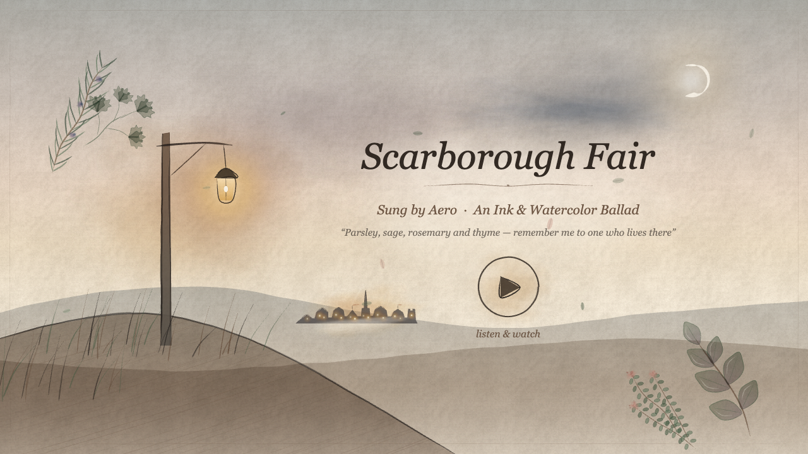
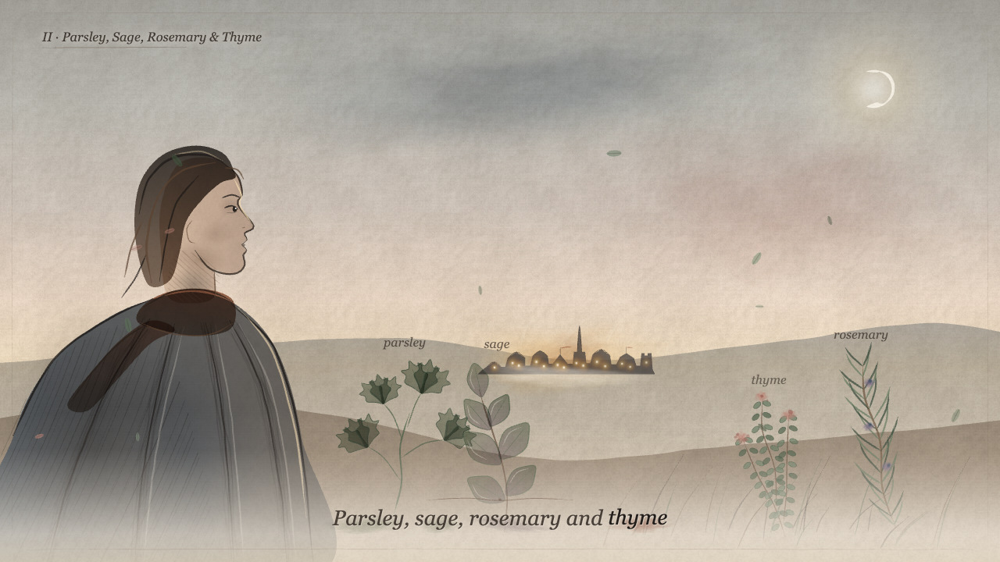
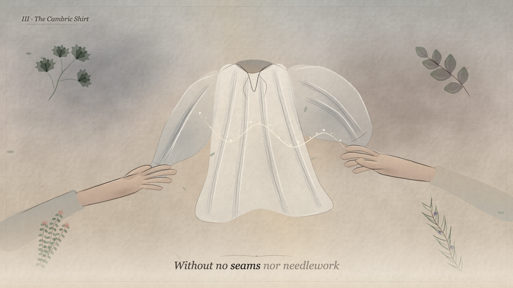
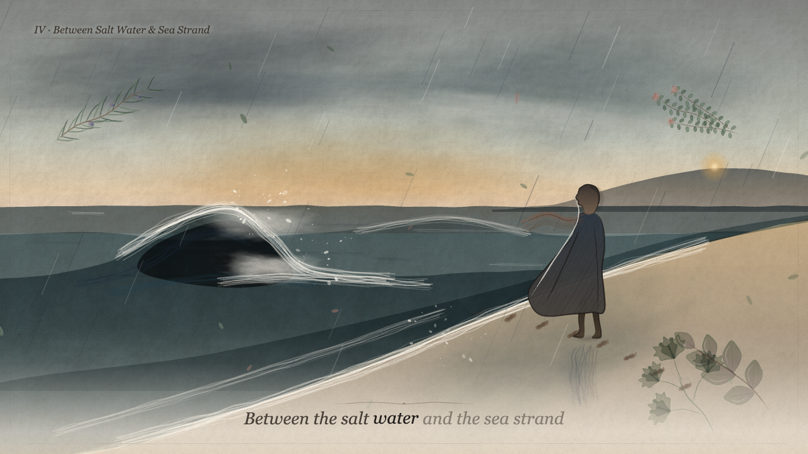
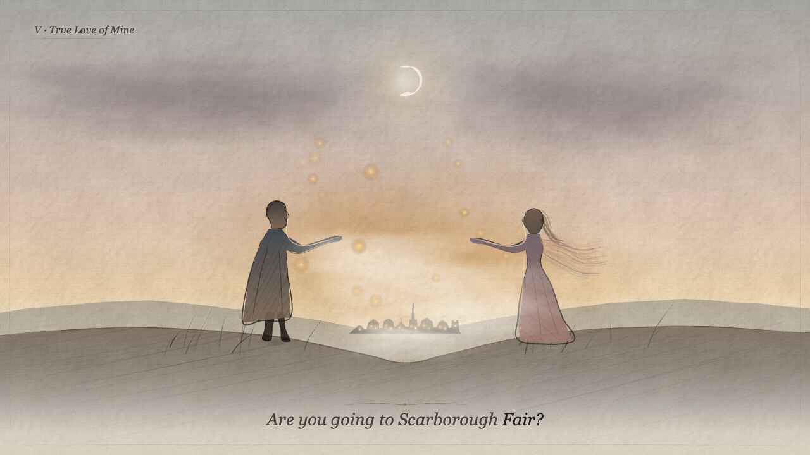

# Aero Sings Scarborough Fair

**Pure-code physical-modeling singing voice in Python stdlib + hand-drawn ink, charcoal & watercolor Canvas 2D animated film — zero external libraries, zero TTS, zero audio samples, zero SVGs, zero assets.**

**[Watch & Listen Live on GitHub Pages →](https://chetaslua.github.io/aero-scarborough-fair/)** *(click the cover sheet to start audio)*



Every sound wave in this 108.8-second performance (singing voice, fingerpicked acoustic guitar, bowed cello, and wooden-hall reverb) is synthesized from scratch using only the Python 3 standard library (`array`, `math`, `random`, `wave`). Every frame of the accompanying 5-act animated short film (cold-press cotton paper, wet-on-wet watercolor washes, vine charcoal, dip-pen contour hatching, and botanical ink drawings) is painted procedurally in real time on HTML5 Canvas 2D with zero external scripts, fonts, or image files.

---

## Preview Gallery

| Act II · *Parsley, Sage, Rosemary & Thyme* | Act III · *The Cambric Shirt* |
| :---: | :---: |
|  |  |

| Act IV · *Between Salt Water & Sea Strand* | Act V · *True Love of Mine* |
| :---: | :---: |
|  |  |

---

## Watch Live or Play Offline

- **Live Demo (GitHub Pages):** Open [https://chetaslua.github.io/aero-scarborough-fair/](https://chetaslua.github.io/aero-scarborough-fair/) and click the cover sheet to start playback.
- **Offline Single-File Player:** No server, build step, or internet connection is required:
  1. Download or clone this repository.
  2. Open [`scarborough_fair_aero.html`](./scarborough_fair_aero.html) directly in any modern browser (Chrome, Safari, Firefox, Edge).
  3. Click anywhere on the cover sheet to start the performance.

`scarborough_fair_aero.html` (~13 MB) is a completely self-contained single-file deliverable with the 22,050 Hz 16-bit stereo WAV audio (`base64`), 30 fps lyric/audio telemetry timeline, and full Canvas 2D rendering engine embedded inline — zero external network requests.

---

## Architecture

Everything is built from first principles with **zero third-party dependencies**:

| File | Role | Dependencies |
| :--- | :--- | :--- |
| [`song_spec.py`](./song_spec.py) | D Dorian musical score (3/4 waltz), rubato tempo map, English phonetic transcription (14 phrases, 98 timed words), herb cues, and 5-act timeline metadata | Python stdlib (`math`) |
| [`voice_synth.py`](./voice_synth.py) | Physical-modeling baritone-tenor singing synthesizer (C3–E4, 22,050 Hz): C1-smooth physiological LF-style glottal flow derivative with 2-stage spectral tilt & chest H1/H2 resonance; 5-formant Klatt cascade vocal tract (F1–F5) with nasal pole-zero coupling & parallel fricative/burst branch; gradual cosine diphthong trajectories & consonant formant loci; legato portamento, delayed organic vibrato, jitter/shimmer, and non-resonant inhale breaths | Python stdlib (`array`, `math`) |
| [`accompaniment.py`](./accompaniment.py) | Extended Karplus-Strong fingerpicked Drop-D acoustic guitar/lute, warm bowed cello / chamber strings (dual alias-free wavetables entering on Verse 2 and swelling on Verse 3), Schroeder/Freeverb stone-and-timber stereo hall reverb (mutually-prime damped combs + unity Schroeder allpass diffusers), gentle vocal-driven ducking & mastering, and 30 fps audio telemetry extraction | Python stdlib (`array`, `math`, `os`, `random`, `sys`, `wave`) |
| [`render_song.py`](./render_song.py) | End-to-end pure-Python audio rendering pipeline generating `build/song_full.wav`, vocal/verse stems, and `build/timeline.json` (3,265 frames at 30 fps) | Python stdlib |
| [`art_engine.js`](./art_engine.js) | Procedural traditional-media Canvas 2D renderer: cold-press cotton rag paper, continuous variable-pressure dip-pen / graphite / vine-charcoal tapered strokes, full-bleed wet-on-wet watercolor washes & pigment blooms, form-following contour hatching, opaque gouache underpainting, and ~8.5 fps hand-drawn animation line boil | Vanilla JS / HTML5 Canvas 2D |
| [`art_scenes.js`](./art_scenes.js) | 5-act visual storytelling choreography (1280×720 logical studio sheet) synced to word-level lyrics, botanical herb triggers (*parsley, sage, rosemary, thyme*), vocal/accompaniment RMS, F0 pitch, and breath curves | Vanilla JS / HTML5 Canvas 2D |
| [`build_html.py`](./build_html.py) | Self-contained HTML bundler that embeds `art_engine.js`, `art_scenes.js`, `build/timeline.json`, and `build/song_full.wav` into `scarborough_fair_aero.html` and verifies zero external URLs | Python stdlib |

---

## Iterative Critique Progression

Audio intelligibility, musicality, and fine-art visual craft were refined across three dedicated review rounds:

| Critic | Round 1 | Round 2 | Round 3 (Final) | Focus |
| :--- | :---: | :---: | :---: | :--- |
| `lyric-critic` | 4.9 / 10 | 7.0 / 10 | **8.4 / 10** | Sung English diction, diphthong clarity, consonant bursts & syllable timing |
| `music-critic` | 5.75 / 10 | 7.6 / 10 | **8.8 / 10** | Vocal warmth, vibrato, rubato phrasing, guitar/cello arrangement & hall mix |
| `visual-critic` | 5.1 / 10 | 8.4 / 10 | **8.85 / 10** | Authentic ink/charcoal/watercolor media feel, composition, lighting & lyric sync |

---

## Rebuild from Scratch

Only **Python 3** is needed — no `pip install`, no NumPy/SciPy, no FFmpeg, no Node.js:

```bash
python3 render_song.py && python3 build_html.py
```

- `render_song.py` synthesizes the full vocal track, acoustic accompaniment, stereo master (`build/song_full.wav`), isolated stems, and 30 fps visual timeline (`build/timeline.json`).
- `build_html.py` packages everything into `./scarborough_fair_aero.html`.

---

## License & Attribution

- ***Scarborough Fair*** is a traditional public-domain English folk ballad.
- All source code and procedural artwork in this repository are licensed under the [MIT License](./LICENSE).
